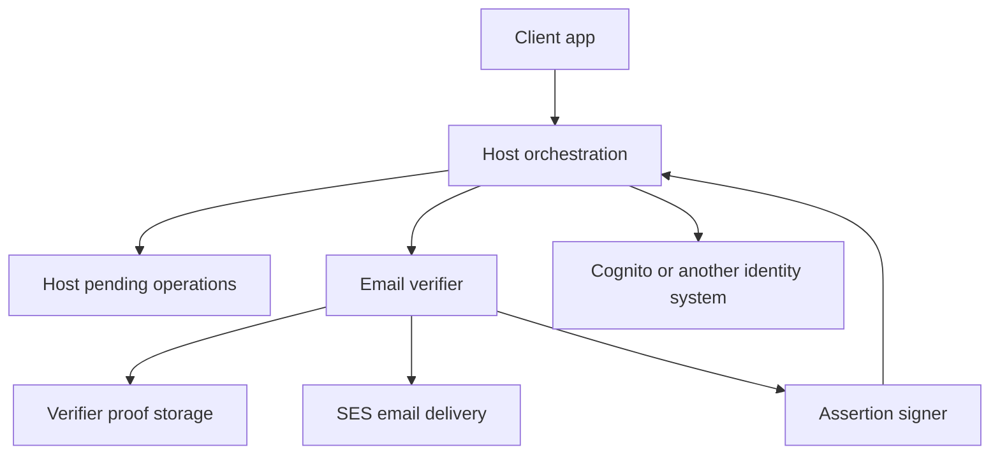
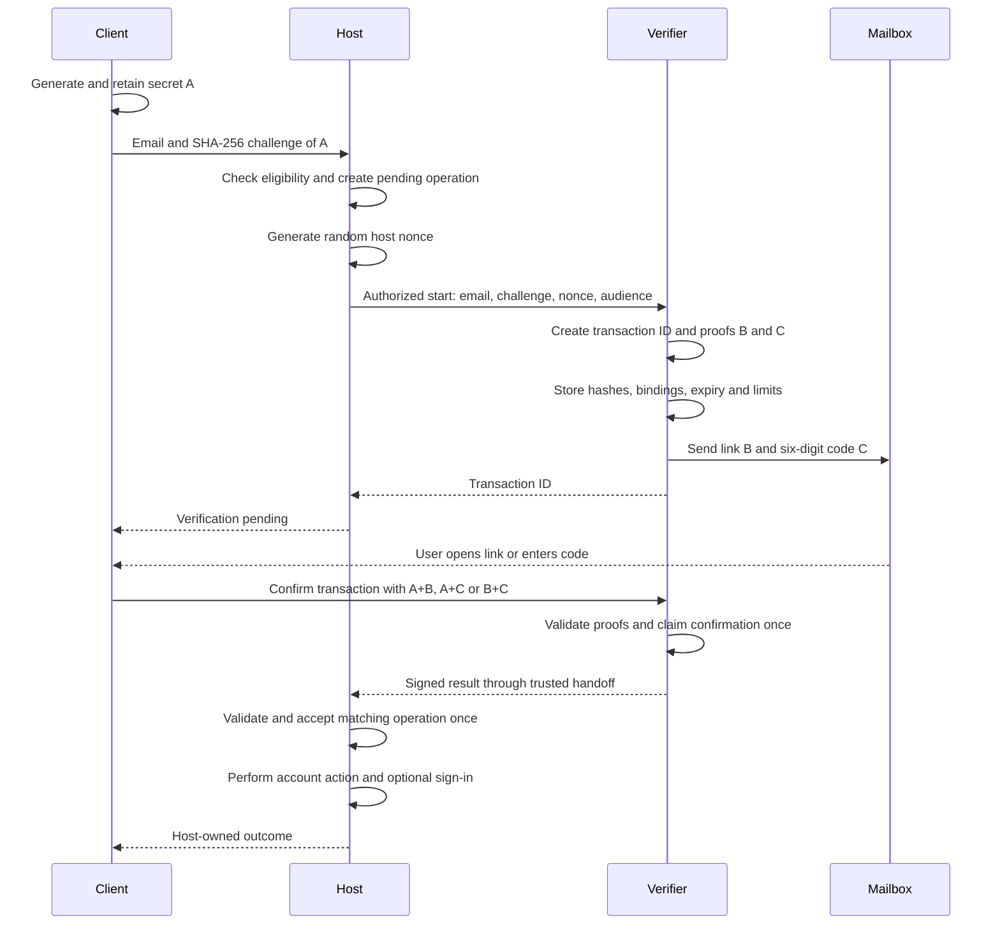
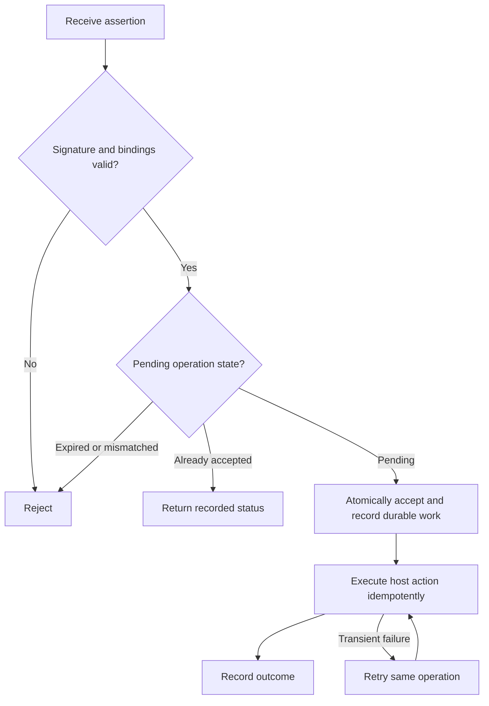

# Plan: verification-only email module

Status: planned architecture from our design discussion; not implemented.
The current native adapter still checks Cognito eligibility, creates users,
and requests sessions. This note describes the intended separation.

The verifier will answer one question: **did someone demonstrate access to this
email address for this particular request?** It will return a signed verification
assertion. The host owns eligibility, accounts, Cognito, sessions, and the action
authorized by that evidence. Cognito integration belongs outside this repository;
its final repository location is still to be decided.

## Responsibility boundary

The host imports and deploys the module. These boxes are responsibility boundaries,
not a requirement for separate services. A composed handler can call the library
directly; separate Lambdas require authenticated, encrypted communication.
A signature does not make evidence independent of the host that controls the
verifier code and signing permissions.

| Responsibility | Today | Planned owner |
| --- | --- | --- |
| Account eligibility lookup | Verifier's Cognito adapter | Host |
| A/B/C verification, expiry, limits and resend | Verifier | Verifier |
| Account creation and session issuance | Verifier's Cognito adapter | Host |
| Signed verification result | Not implemented | Verifier |
| Operation binding and single-use acceptance | New host contract needed | Host |

## Proposed verification flow

The sequence is logical: exact public routes and result delivery remain to be
specified. The verifier must accept host bindings only through an authorized
start path, not trust arbitrary client-supplied audience or nonce values.

A stays on the initiating client until confirmation; the backend stores its
challenge. The verifier generates B and C. Preserve the existing ten-minute
proof lifetime, hashed B, keyed digest of C, retry budgets, cooldowns, conditional
claims, and resend invalidation. B+C remains a cross-device fallback: access to
the entire email exposes both, so it cannot resist mailbox compromise.

## Signed result and request binding

The host generates a cryptographically random nonce (proposed: 32 bytes) and
stores its association with the expected email, intended operation, account or
signup context, initiating session, and expiry. The verifier creates its own
transaction ID. Keep the two identifiers separate; neither is an authorization
credential by itself.

| Signed field | Purpose |
| --- | --- |
| Issuer and audience | Identify the trusted verifier and intended host |
| Email and successful verification result | State what was verified |
| Host nonce | Bind evidence to the host's pending operation |
| Verifier transaction ID | Identify this verification transaction |
| Verification time, issuance time and expiration | Bound freshness and acceptance |
| Assertion ID | Identify the result for deduplication |

This is evidence of mailbox access, not an access token or proof of legal identity.
Operation names can remain private to the host through the nonce mapping.

## Replay prevention and crash recovery

A signature prevents tampering; it does not prevent replay or a thief submitting
first. Host acceptance must check the trusted key and allowed algorithm, issuer,
audience, time bounds, email, nonce, transaction, and original operation context.
Concurrent acceptance must have one winner. Atomically record acceptance and
durable follow-up work, then make external actions retry-safe. Do not claim a
distributed exactly-once guarantee.

The verifier also needs recoverable result issuance/delivery after successful
confirmation: retrying delivery must preserve the same verification identity,
never perform a new verification or authorize another operation. The persistence
and retry mechanism is still to be designed.

## Next implementation decisions

- Define the assertion schema, signing algorithm, trusted-key distribution and
  rotation. JWT/JWS is a candidate format, not an OAuth or OIDC flow.
- Define direct-call and separate-Lambda contracts, including authorized initiation,
  result delivery, recovery and client completion behavior.
- Move eligibility, Cognito enrollment and grants/session code to the host side;
  remove their permissions and integration requirements from the verifier.
- Add shared assertion validation and host acceptance contracts; keep signing
  keys separate from the existing proof HMAC key.
- Test replay races, wrong audience/email/nonce, expired results, stolen B without
  A, resend invalidation, and crashes before and after acceptance.
- Review applicable standards before claiming conformance. PKCE-style binding,
  signed assertions and webhook-style deduplication are design inspirations;
  no NIST compliance or EVP interoperability is claimed.

Keep proofs and signed assertions out of logs and result URLs. Deliver results
through a direct trusted return when composed, or an authenticated backend
handoff when separated. No AWS deployment, proof-key rotation or data migration
is part of this documentation change.
